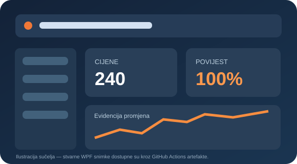

# SIDRENA
### Cijene pod kontrolom. Poslovanje s povjerenjem.

**Premium Windows aplikacija i službeni WordPress dodatak za cijene, povijest i cjenike.**

[**Preuzmi Windows**](https://github.com/bren-wp/SIDRENA/releases/tag/1.5.0) · [**WordPress.org**](https://wordpress.org/plugins/brendigo-sidrena-cijena/) · [**Podrška**](mailto:sidrena@brendigo.com)

---

## Vaše poslovanje na jednom mjestu

SIDRENA pojednostavnjuje svakodnevni rad s cijenama, artiklima, uslugama, poslovnicama i izvještajima. Brza pretraga, transparentna povijest promjena i pregledni cjenici daju vam kontrolu i jasnoću.

<table><tr><td width="54%">

### ✦ SIDRENA Desktop

- **Artikli i usluge** — pretraživanje, uređivanje i evidencija.
- **Povijest cijena** — promjene, razlozi i grafički prikaz.
- **Referentne cijene** — povijesna vrijednost uz dokazivi izvor.
- **Cjenici** — CSV/XML i pregled za ispis.
- **Poslovnice i arhiva** — povezani poslovni pregled.
- **Sigurnosne kopije** — jednostavno spremanje i vraćanje.
- **WordPress pregled** — javni cjenici i objavljene arhive službenog dodatka.

</td><td width="46%">

*Ilustracija, ne stvarni screenshot.*

</td></tr></table>

###  Windows preuzimanje

| Instalacija (Setup.exe) | Bez instalacije (Portable.exe) |
|---|---|
| Moderan instalacijski čarobnjak s prikazom licence, prečacima i deinstalacijom. | Samostalna aplikacija za Windows 10/11 x64. |
| [**Preuzmi Setup**](https://github.com/bren-wp/SIDRENA/releases/download/1.5.0/SIDRENA-Desktop-win-x64-Setup.exe) | [**Preuzmi Portable**](https://github.com/bren-wp/SIDRENA/releases/download/1.5.0/SIDRENA-Desktop-win-x64-Portable.exe) |

[SHA-256 datoteka za provjeru integriteta](https://github.com/bren-wp/SIDRENA/releases/download/1.5.0/SIDRENA-Desktop-win-x64-SHA256SUMS.txt) · [Sve datoteke izdanja](https://github.com/bren-wp/SIDRENA/releases/tag/1.5.0)

**Stvarne snimke zaslona:** Windows CI sprema 30 WPF prikaza (10 standardnih, 10 kompaktnih i 10 srednjih) u [GitHub Actions artefakte](https://github.com/bren-wp/SIDRENA/actions/workflows/desktop-ci.yml). Snimke služe provjeri i nisu zamjena za ručnu 1:1 usporedbu.

## 🌐 Brendigo Sidrena Cijena za WordPress

Službeni WordPress dodatak **Brendigo Sidrena Cijena 1.5.0** dostupan je [na WordPress.org](https://wordpress.org/plugins/brendigo-sidrena-cijena/). U ovom repozitoriju nalazi se jedna, službena varijanta dodatka: [WordPress izvor](wordpress/brendigo-sidrena-cijena/).

Windows aplikacija može preko HTTPS-a čitati javno dostupne cjenike, arhivu i izvore po poslovnicama. **Dvosmjerna autorizirana sinkronizacija i automatizirana javna objava još nisu omogućene.** Datoteke pripremljene u Windowsu treba provjeriti prije uporabe kao zakonskog javnog cjenika.

## 🔒 Privatnost i pouzdanost

U SIDRENA Desktopu čuvamo poslovnu evidenciju s provjerenim sigurnosnim kopijama, zaštitom podataka pri radu s datotekama i ograničenjima za povezivanje s web-stranicama. Aplikacija ne prikazuje interne datotečne putanje ni tehničke sadržaje pogrešaka. Javne WordPress podatke čita preko HTTPS-a, bez prijenosa vašega lokalnog kataloga.

## ✨ Izgled i iskustvo

Prepoznatljiv tamnoplavi identitet, topli narančasti detalji, vektorske ikone i prilagodljivo sučelje za različite veličine zaslona. Aplikacija se otvara u normalnom prozoru, bez prisilnog fullscreen načina rada.

## © Brendigo LTD

**Nositelj i komercijalni izdavač Windows aplikacije:** Brendigo LTD, uz potvrdu lanca prava na izvorni kod i komponentama.

[**Komercijalna EULA**](desktop/legal/EULA-HR.txt) · [**Razgraničenje licenci**](LICENSE-SCOPE.md) · [**Treće komponente**](desktop/legal/THIRD-PARTY.md)

Službeni WordPress dodatak ostaje pod GPLv2 ili novijom. Nova EULA ne može retroaktivno poništiti ranije valjano dodijeljena GPL prava. Prije komercijalne prodaje potrebno je potvrditi registrirane podatke društva, model prodaje, sve licencije i ugovorne uvjete.

## Jedno službeno izdanje

Samo **jedan GitHub Release i tag: 1.5.0**. Službeni WordPress ZIP i njegova SHA-256 datoteka ostaju netaknuti, dok uspješan Windows build na main zamjenjuje samo Windows Portable.exe, Setup.exe i njihove kontrolne datoteke. Windows ima zasebnu internu verziju (Windows **0.10.1**).

[Windows dokumentacija](desktop/README.md) · [Instalacija](desktop/installer/README.md) · [UI audit](docs/DESKTOP-07-AUDIT.md)

---

<strong>SIDRENA · Brendigo LTD</strong>

[Brendigo](https://brendigo.com/) · [Windows](https://github.com/bren-wp/SIDRENA/releases/tag/1.5.0) · [WordPress.org](https://wordpress.org/plugins/brendigo-sidrena-cijena/)

